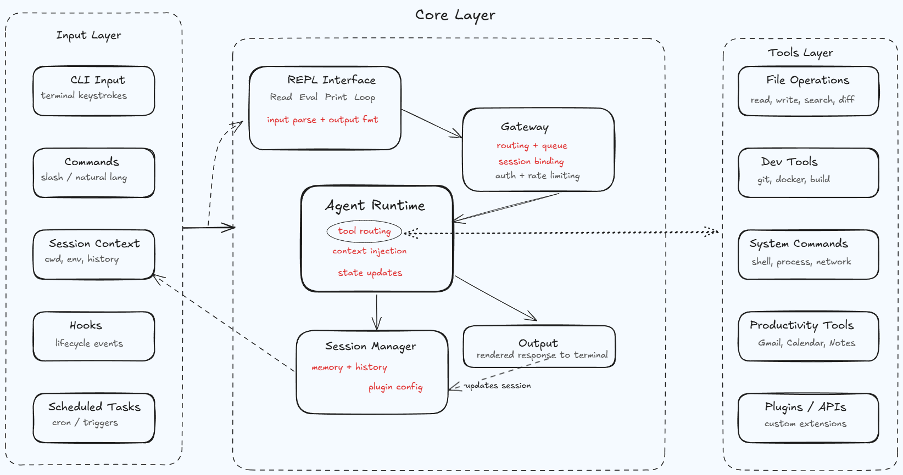
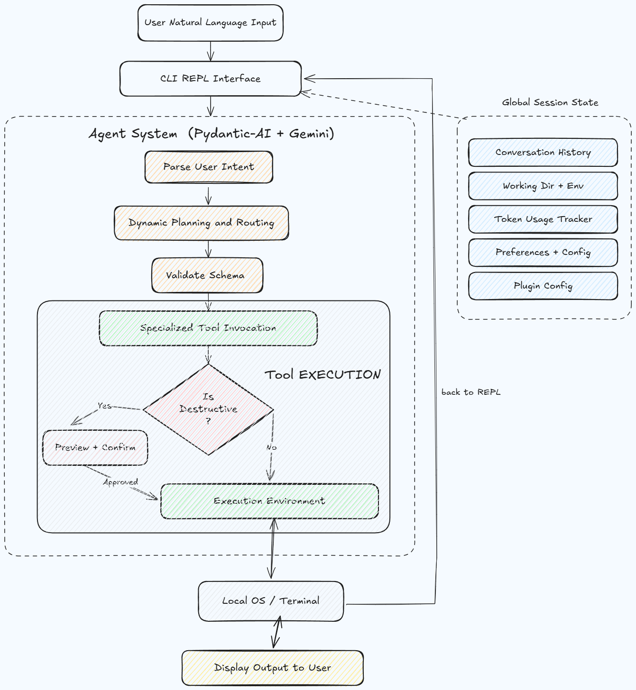
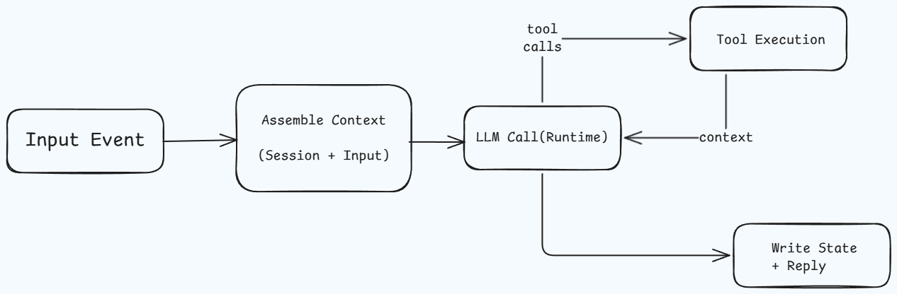
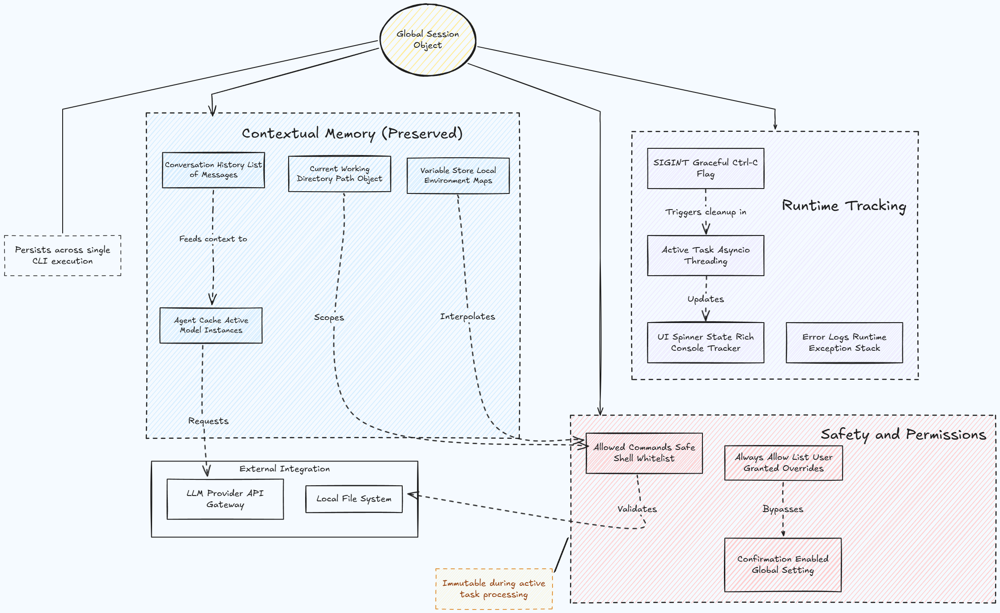

# Terminus CLI Architecture

This document describes the current Terminus architecture as implemented in the codebase, with a focus on system structure, runtime workflow, the agent loop, and session lifecycle.

## Table of Contents

- [1. System Overview](#1-system-overview)
- [2. Runtime Architecture](#2-runtime-architecture)
- [3. Request Workflow](#3-request-workflow)
- [4. Agent Loop](#4-agent-loop)
- [5. Session Model](#5-session-model)
- [6. Tool System](#6-tool-system)
- [7. Safety and Execution Controls](#7-safety-and-execution-controls)
- [8. Configuration and Model Management](#8-configuration-and-model-management)
- [9. Persistence and Context Memory](#9-persistence-and-context-memory)
- [10. Evaluation and Observability](#10-evaluation-and-observability)
- [11. Project Structure](#11-project-structure)
- [12. Extending Terminus](#12-extending-terminus)

## 1. System Overview

Terminus is a terminal-native AI assistant built around a single orchestrating agent and a large set of specialized tools.

Core principles:

- Tool-first execution over free-form responses.
- Action-oriented behavior for operational requests.
- Confirmation gates for risky or destructive actions.
- Session-aware operation (directory, history, preferences).
- Extensible architecture with modular tool registration.




- Scope: High-level map of the full Terminus system.
- Main idea: 

    User input enters through the CLI/REPL, then flows into the core agent, which orchestrates tools and infrastructure services.
- Boundaries: 

    `core` owns orchestration, `tools` owns capabilities, `infrastructure` owns provider/runtime integrations, and `ui`/`utils` support interaction and reliability.
- Why it matters: This is the fastest way to see which layer to change when adding features or debugging behavior.

## 2. Runtime Architecture

### Entry Point

The CLI starts in `src/terminus/__main__.py`.

Startup sequence:

1. Initialize logging.
2. Load and validate config (`core/config.py`).
3. Initialize global session state (`core/session.py`).
4. Load optional project guide (`terminus.md`).
5. Start the REPL loop (`core/repl.py`) inside an asyncio event loop.

### Core Runtime Components

- `core/repl.py`: input loop, command dispatch, cancellation, and response rendering.
- `core/agent.py`: agent creation, prompt selection, request processing, node handling.
- `core/session.py`: in-memory global session state.
- `core/deps.py`: dependency contract passed into tools (`confirm_action`, `display_tool_status`).
- `tools/wrapper.py`: central tool registry.
- `infrastructure/*`: model detection/switching, persistence, natural-language pre-processing, state manager.

## 3. Request Workflow

Each user request follows a deterministic high-level path.

1. User submits prompt in REPL.
2. REPL starts spinner and creates async request task.
3. `process_request(...)` applies optional natural-language normalization.
4. Agent is created or reused with model, prompt, tools, and deps.
5. Agent streams tool calls and text nodes.
6. Tool outputs and model responses are appended to session history.
7. Final response is rendered.
8. Context is persisted (state manager + session autosave when applicable).




## 4. Agent Loop

The agent loop is implemented in `core/agent.py` and uses `pydantic_ai.Agent` with an iterative streaming execution model.

### Agent Creation

`get_or_create_agent()`:

- Configures model runtime compatibility (including Ollama/OpenAI compatibility mode).
- Selects model-specific system prompt.
- Instantiates a single default agent with:
  - active model
  - system prompt
  - registered tool list
  - dependency type (`ToolDeps`)

### Processing Pipeline

`process_request(message)`:

1. Applies natural-language pre-processing (`infrastructure/natural_language.py`) for common command intents.
2. Optionally forces direct tool execution for certain local-model scenarios.
3. Builds message history from `session.messages`.
4. Prepends project guide context when available.
5. Creates runtime deps callbacks:
   - `confirm_action` for safe execution gating
   - `display_tool_status` for tool progress output
6. Executes `agent.iter(...)` and streams nodes.
7. Processes nodes and updates history.
8. Returns synthesized final output.

### Node Handling

The loop reacts to streamed node parts such as:

- tool calls (`ToolCallPart`)
- tool returns (`ToolReturnPart`)
- text/thinking content (`TextPart`)

Errors are patched back into tool history to preserve conversational consistency.




- Scope: Internal execution loop inside `process_request()` and `agent.iter(...)`.
- Main idea: The model emits nodes/parts, Terminus executes tool calls, appends history, and feeds results back until a final output is produced.
- Key mechanics: Node streaming, tool dependency callbacks (`confirm_action`, `display_tool_status`), and history patching on errors.
- Why it matters: This explains how multi-step tool chains are created dynamically from one natural-language prompt.

## 5. Session Model

Session state is centralized in `core/session.py` via a global `session` instance.

Key responsibilities:

- Active model tracking.
- Agent cache (`session.agents`).
- Message history (`session.messages`).
- Working directory management (`change_directory`, `get_cwd`, `resolve_path`).
- Confirmation policy state.
- Runtime task/spinner/signal state.
- Optional debug state.

Session initialization occurs once at startup (`session.init(config, model)`) and is updated continuously during REPL operation.



Diagram explanation:

- Scope: What the global `session` stores and how it changes over time.
- Main idea: Session keeps durable runtime context (model, cwd, message history, confirmations, running task state).
- Lifecycle: Initialized at startup, mutated on every request, and partially persisted/restored through infrastructure persistence.
- Why it matters: If behavior seems inconsistent between requests, session state is the first place to inspect.


Tools are grouped under `src/terminus/tools/` and registered in `tools/wrapper.py`.

Current registry size: 44 tools.

High-level categories:

- File operations (read/write/update/find/grep/list/cd/path-aware run).
- Development workflow (git helpers, README generation, refactor analysis, quick stats).
- Analysis (code summarization, project analysis, refactor/review/complexity/duplication checks).
- Integrations (Gmail, Calendar, Google auth lifecycle).

### Execution Contract

Each tool runs with a `RunContext[ToolDeps]`, enabling:

- optional confirmation callback
- optional progress/status callback

This keeps tool implementations isolated while still connected to UI safety and progress feedback.

## 7. Safety and Execution Controls

Safety is enforced through multiple layers:

- Confirmation UI for non-safe operations.
- Per-tool "always allow" session overrides.
- Command allowlist in config (`settings.allowed_commands`) for shell execution paths.
- Graceful cancellation and cleanup via signal/task handling.
- Error context wrapper with user-friendly output and optional detailed logging.

Safe-only tools are explicitly listed in constants for bypassing confirmations where appropriate.

## 8. Configuration and Model Management

### Configuration

- File: `~/.config/terminus.json`
- Managed by `core/config.py`
- Supports:
  - default model
  - environment variables (API keys/secrets)
  - command allowlist and settings
  - Gmail/Calendar defaults

`ensure_config_structure()` deep-merges user config with defaults so upgrades remain backward compatible.

### Models

`infrastructure/models.py` manages provider detection and switching:

- Google model availability checks.
- Ollama local model discovery.
- Best-available fallback selection.
- Runtime model switching with config persistence.

## 9. Persistence and Context Memory

Two complementary persistence mechanisms are present:

1. `infrastructure/persistence.py`
   - Saves/loads session snapshots.
   - Maintains recent session history.
   - Supports auto-save and auto-restore behavior.

2. `infrastructure/state_manager.py`
   - Tracks recent context entries and command history.
   - Supports project tags and per-tag context.
   - Maintains fuzzy command patterns and suggestions.

This design preserves operational continuity while keeping runtime session state lightweight.

## 10. Evaluation and Observability

Terminus includes an evaluation and observability workflow for validating tool routing and measuring runtime quality.

- `evals/`: offline prompt-to-tool routing checks and dataset-based evaluation.
- `observability/`: Opik-based tracing, metrics, and evaluation instrumentation.

Primary goals:

- verify correct tool selection
- measure latency/quality trends
- reduce unsafe or incorrect execution behavior

## 11. Project Structure

```text
src/terminus/
  __main__.py
  constants.py
  core/
    agent.py
    repl.py
    session.py
    deps.py
    commands.py
    config.py
    setup.py
  infrastructure/
    models.py
    natural_language.py
    persistence.py
    state_manager.py
    ollama.py
  tools/
    file_ops/
    dev_tools/
    analysis/
    integrations/
    wrapper.py
  interfaces/
  prompts/
  ui/
  utils/
```

## 12. Extending Terminus

To add a new capability:

1. Implement a typed tool function in the correct `tools/*` module.
2. Include clear docstrings (used by the model for tool selection quality).
3. Add safety handling via `ctx.deps.confirm_action` if action can mutate state.
4. Register the tool in `tools/wrapper.py`.
5. Add tests/evals for routing and behavior.

