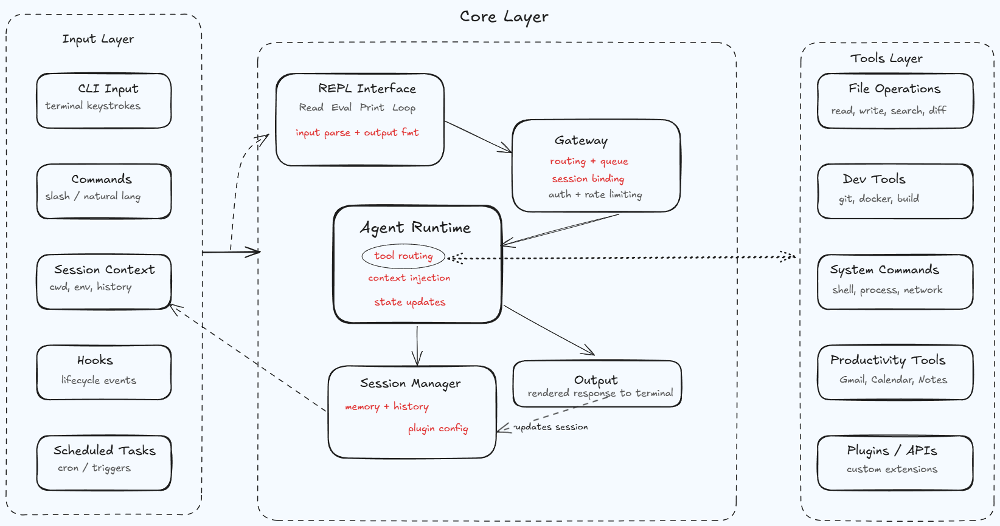

# Terminus CLI

Terminus is a terminal-native AI automation assistant that executes real work through a tool-first architecture.

It is designed for engineers who want natural-language task execution in the terminal without losing control, context, or safety.

## Why Terminus

- Terminal-first workflow with no IDE lock-in.
- Single-agent orchestration with specialized tool execution.
- Session-aware context (history, working directory, preferences).
- Confirmation gates for risky actions.
- Extensible architecture for adding new capabilities quickly.


  

For architecture details, see:

- [docs/ARCHITECTURE.md](docs/ARCHITECTURE.md)

## Core Capabilities

- Natural-language execution for file, project, and system workflows.
- Tool-driven operations for search, edits, analysis, and command execution.
- Development workflows for Git, project scaffolding, and code insights.
- Gmail/Calendar integrations with explicit safety boundaries.
- Model management with cloud and local fallback support.
- Session persistence and context tracking across runs.

## Requirements

- Python 3.10+
- Gemini API key for cloud model usage
- Optional: Ollama for local/offline model usage
- Optional: Google OAuth credentials for Gmail/Calendar integrations

## Installation

### Option A: pipx (recommended for CLI usage)

```bash
pip install pipx
pipx install terminus-cli
```

### Option B: pip

```bash
pip install terminus-cli
```

### Option C: local development install

```bash
git clone <repository-url>
cd terminus-cli
python -m venv env
```

Windows:

```bash
env\Scripts\activate
```

macOS/Linux:

```bash
source env/bin/activate
```

Install package and development dependencies:

```bash
pip install -e .
pip install pytest pytest-asyncio python-dotenv opik
```

## Quick Start

Launch Terminus:

```bash
terminus
```

On first run, the setup flow creates and validates config, then asks for required keys.

Example prompts:

```text
analyze this project structure and suggest improvements
find all TODO comments and summarize by file
show files larger than 100MB
schedule a 30-minute meeting tomorrow at 2pm
```

## Configuration

Config file location:

- `~/.config/terminus.json`

Minimum config example:

```json
{
  "default_model": "google-gla:gemini-2.5-flash",
  "env": {
    "GEMINI_API_KEY": "your-api-key"
  }
}
```

Extended env keys for integrations:

- `GOOGLE_CLIENT_ID`
- `GOOGLE_CLIENT_SECRET`

Runtime updates are also available from slash commands, for example:

- `/config`
- `/config key <new_api_key>`
- `/config model <model_name>`

## Built-in Slash Commands

### Basic

- `/help`
- `/status`
- `/version`
- `/clear`
- `/yolo` (disables confirmations; use with caution)

### Context and Memory

- `/dump`
- `/history`
- `/tag create <name> [notes]`
- `/tag remove <name>`
- `/switch #<tag>`

### Models and Runtime

- `/models`
- `/switch <model_name>`
- `/offline`
- `/config`

### Session Management

- `/sessions [--clear]`
- `/save [name]`
- `/load <name>`
- `/cleanup`

## Safety Model

- Non-destructive operations are allowed directly.
- Destructive or risky actions require confirmation by default.
- Per-tool "always allow" can be set for the current session.
- `/yolo` turns off confirmations globally for the session.

## Evaluations and Observability

Generate and run routing evaluations:

```bash
python evals/generate_evals.py
pytest evals/test_evals.py
```

Run Opik-based evaluation pipeline:

```bash
python observability/opik_evaluate_dataset.py
```

Set required env values in [observability/.env.example](observability/.env.example) before running observability scripts.

## Project Layout

```text
src/terminus/
  core/
  tools/
  infrastructure/
  ui/
  utils/
```

## License

MIT
